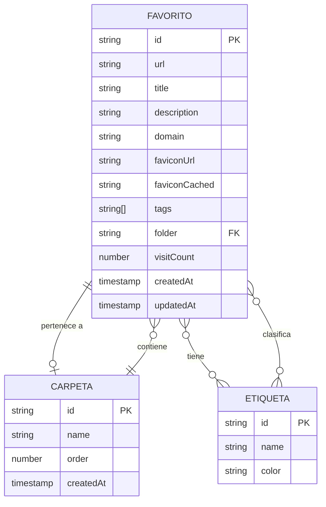
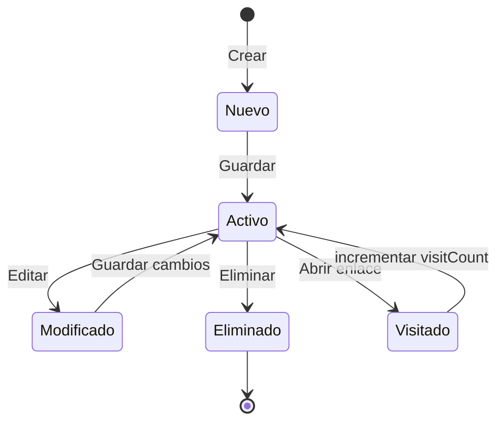
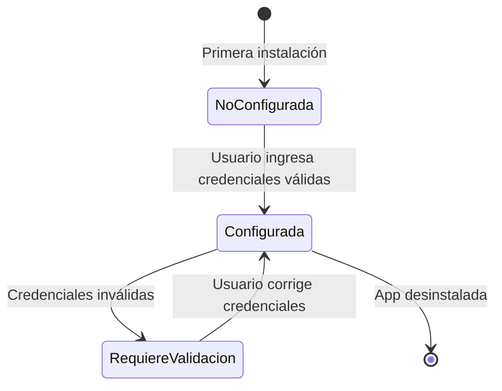

# Data Model - Favoritos Desktop

**Feature**: 001-favoritos-desktop
**Date**: 2026-03-07
**Status**: Complete

## Overview

Este documento define el modelo de datos de la aplicación, incluyendo entidades, sus atributos, relaciones y reglas de validación.

---

## Entidades

### 1. Favorito

Representa un enlace guardado por el usuario.

**Atributos**:

| Campo | Tipo | Nullable | Descripción |
|-------|------|----------|-------------|
| `id` | string | No | Identificador único (UUID) |
| `url` | string | No | URL del enlace |
| `title` | string | No | Título del favorito |
| `description` | string | Sí | Descripción opcional |
| `domain` | string | No | Dominio extraído de la URL |
| `faviconUrl` | string | Sí | URL del favicon original |
| `faviconCached` | string | Sí | Ruta local del favicon cacheado |
| `tags` | string[] | Sí | Array de etiquetas (IDs o nombres) |
| `folder` | string | Sí | ID o nombre de la carpeta |
| `visitCount` | number | No | Contador de visitas (default: 0) |
| `createdAt` | timestamp | No | Fecha de creación |
| `updatedAt` | timestamp | No | Fecha de última actualización |

**Reglas de Validación**:
- `url`: Debe ser una URL válida (http/https)
- `title`: Mínimo 1 carácter, máximo 200
- `domain`: Se extrae automáticamente de la URL
- `tags`: Máximo 10 etiquetas por favorito
- `visitCount`: No puede ser negativo

**Relaciones**:
- Pertenece a una `Carpeta` (opcional)
- Tiene múltiples `Etiqueta` (opcional)

---

### 2. Carpeta

Agrupa favoritos según criterios del usuario.

**Atributos**:

| Campo | Tipo | Nullable | Descripción |
|-------|------|----------|-------------|
| `id` | string | No | Identificador único |
| `name` | string | No | Nombre de la carpeta |
| `order` | number | No | Posición de ordenamiento |
| `createdAt` | timestamp | No | Fecha de creación |

**Reglas de Validación**:
- `name`: Mínimo 1 carácter, máximo 50, único por usuario
- `order`: Entero no negativo

**Relaciones**:
- Tiene múltiples `Favorito`

---

### 3. Etiqueta

Clasificación flexible de favoritos. Un favorito puede tener múltiples etiquetas.

**Atributos**:

| Campo | Tipo | Nullable | Descripción |
|-------|------|----------|-------------|
| `id` | string | No | Identificador único |
| `name` | string | No | Nombre de la etiqueta |
| `color` | string | Sí | Color hexadecimal para UI (opcional) |

**Reglas de Validación**:
- `name`: Mínimo 1 carácter, máximo 30, único por usuario
- `color`: Formato hexadecimal válido si proporcionado (ej: `#E6E6FA`)

**Relaciones**:
- Pertenece a múltiples `Favorito`

---

### 4. Configuración

Almacena las credenciales de conexión a la API.

**Atributos**:

| Campo | Tipo | Nullable | Descripción |
|-------|------|----------|-------------|
| `apiUrl` | string | No | URL base de la API |
| `apiKey` | string | No | API Key para autenticación |

**Reglas de Validación**:
- `apiUrl`: Debe ser una URL válida
- `apiKey`: Cadena no vacía

**Nota**: Estos datos se almacenan en el keychain del SO, no en localStorage.

---

### 5. ImportResult

Resultado de una operación de importación masiva.

**Atributos**:

| Campo | Tipo | Descripción |
|-------|------|-------------|
| `imported` | number | Cantidad de favoritos importados exitosamente |
| `skipped` | number | Cantidad de favoritos saltados (duplicados, inválidos) |
| `errors` | string[] | Lista de mensajes de error |

---

## Diagrama de Relaciones



---

## Transiciones de Estado

### Favorito



### Configuración



---

## Esquema de API (Contrato)

La aplicación consume la API REST de Favoritos. A continuación se documentan los endpoints relevantes:

**Nota**: Ver `contracts/api-endpoints.md` para el contrato completo de la API.

---

## Almacenamiento Local

### Datos Persistentes

| Dato | Ubicación | Razón |
|------|-----------|-------|
| API Key | Keychain del SO | Seguridad |
| API URL | Keychain del SO | Seguridad |
| Favoritos (caché) | IndexedDB o similar | Offline read |
| Favicons | Directorio temporal Tauri | Performance |
| Preferencias UI | localStorage | Configuración no sensible |

### Estrategia de Caché

1. **Favoritos**: Se cachearan tras la primera carga exitosa
2. **Favicons**: Se cachean por dominio con TTL de 30 días
3. **Configuración**: Se lee del keychain en cada inicio

---

## Validaciones por Capa

### Frontend (TypeScript/Svelte)

```typescript
// ejemplos de validación
const validateUrl = (url: string): boolean => {
    try {
        new URL(url);
        return url.startsWith('http://') || url.startsWith('https://');
    } catch {
        return false;
    }
};

const validateTitle = (title: string): boolean => {
    return title.length >= 1 && title.length <= 200;
};
```

### Backend (Rust)

```rust
// ejemplos de validación
use url::Url;
use validator::validate_length;

pub fn validate_favorito_url(url: &str) -> Result<Url, String> {
    let parsed = Url::parse(url)
        .map_err(|_| "URL inválida".to_string())?;

    match parsed.scheme() {
        "http" | "https" => Ok(parsed),
        _ => Err("Solo se permiten URLs http/https".to_string())
    }
}
```

---

## Consideraciones de Performance

### Tamaños Máximos

| Entidad | Límite | Justificación |
|---------|--------|---------------|
| Favoritos por usuario | 10,000 | SC-006 |
| Etiquetas por favorito | 10 | UX razonable |
| Longitud de título | 200 | UI legibilidad |
| Longitud de descripción | 1000 | Comentarios razonables |

### Optimizaciones

1. **Indexación**: Búsqueda por título y URL debe ser <50ms
2. **Virtualización**: Solo renderizar favoritos visibles en viewport
3. **Debouncing**: Búsqueda con 300ms de debounce
4. **Batching**: Actualizaciones de estado en lotes

---

## Migraciones

### Cambios Futuros Considerados

1. **Soporte para iconos custom**: Extender `Favorito` con `iconUrl`
2. **Notas**: Añadir campo `notes` de texto largo
3. **Archivado**: Re-introducir `isArchived` si se solicita
4. **Papelera**: Añadir `deletedAt` en lugar de borrado definitivo
